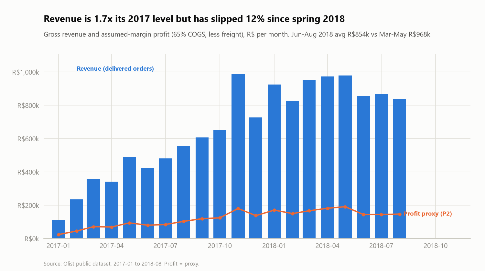
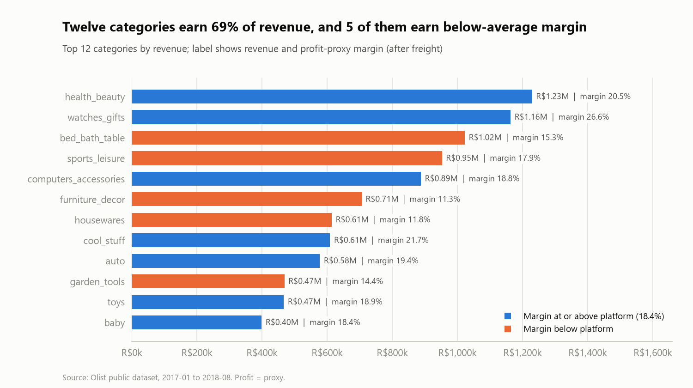
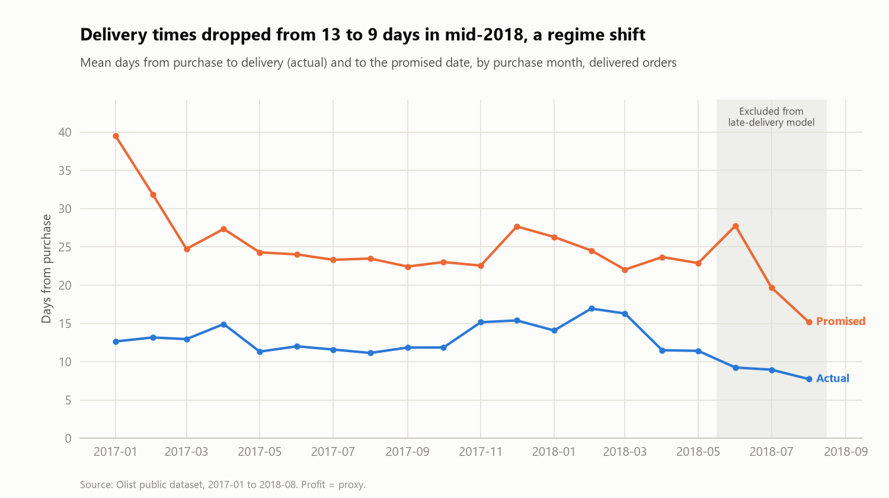
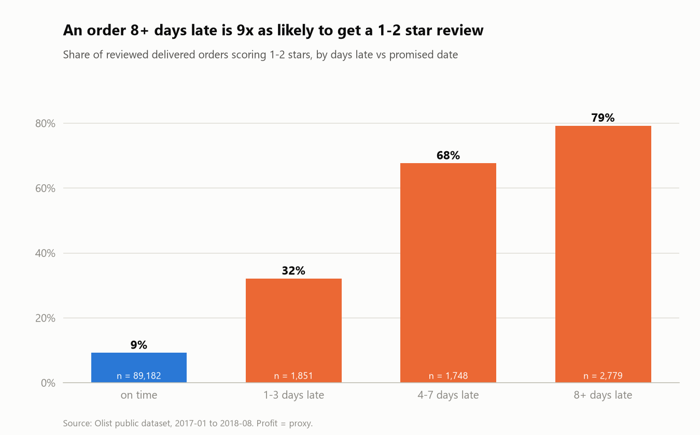
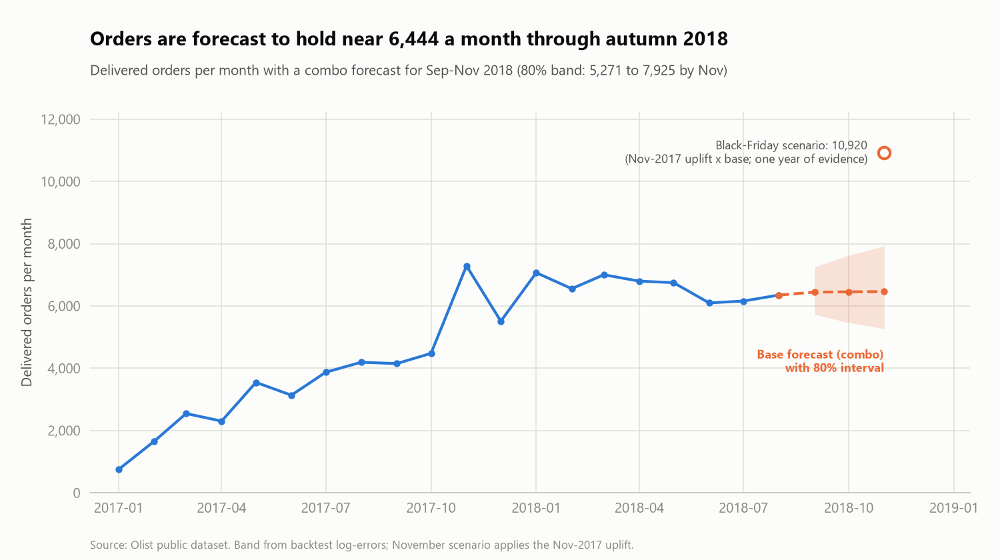
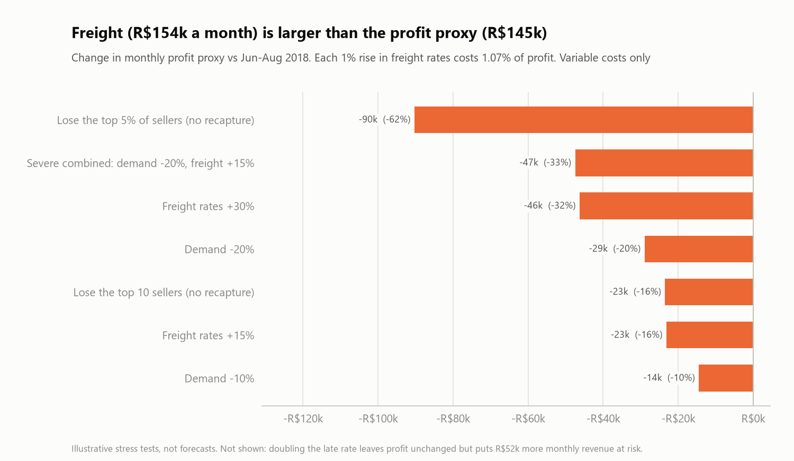

# Retail Profitability, Demand Forecasting and Operational Risk

An end-to-end analytics case study on the [Olist Brazilian e-commerce dataset](https://www.kaggle.com/datasets/olistbr/brazilian-ecommerce): SQL data model, KPI layer, demand forecast, risk metrics, three predictive risk models, a Power BI model and a written report. The emphasis is on **defensible** analysis: reconciled numbers, leakage-safe modelling, honest uncertainty, and cost figures that state their assumptions.

> **Headline:** freight (R$154k a month) is larger than the entire profit proxy (R$145k), so profit is far more exposed to shipping costs than to demand. Late deliveries drive bad reviews (a late order is 6.7x as likely to get 1-2 stars), but most predictive interventions barely pay: the honest recommendation is cheap, rule-first operations.

## Business questions
1. Which categories, sellers and regions drive profit, and how concentrated is revenue?
2. What does monthly demand look like, and can it be forecast?
3. Where is the operational risk, and what does it put at stake?
4. Which sellers are highest risk, and how should they be flagged?

## Key results
| | |
|---|---|
|  |  |
| Revenue is 1.7x its 2017 level but 12% below spring 2018. | Twelve categories earn 69% of revenue; five earn below-average margin because of freight. |
|  |  |
| Delivery times shifted in June 2018 (a regime shift the models must respect). | A late order is 6.7x as likely to get a 1-2 star review. |
|  |  |
| Orders forecast near 6,450 a month; November is a labelled scenario. | Freight is larger than the profit proxy, so profit is highly freight-sensitive. |

Full write-up: [reports/REPORT.md](reports/REPORT.md). Method and decisions: [docs/](docs/).

## Approach
| Layer | What it does | Where |
|---|---|---|
| **SQL** | SQLite build from raw CSVs; typed dimensions and facts at explicit grains; KPI views with window functions; 22 reconciliation tests against independent pandas calculations | `sql/`, `src/olist_risk/build_db.py` |
| **EDA** | Seven charts with data-driven headlines; found a delivery-time regime shift from June 2018 | `src/olist_risk/eda.py` |
| **Forecast** | Rolling-origin backtest of six methods on 20 monthly points; honest about what cannot be learned | `src/olist_risk/forecast.py` |
| **Risk metrics** | Volatility, drawdown, HHI, stress tests, COGS sensitivity | `src/olist_risk/risk.py` |
| **Predictive models** | Late delivery, low review, seller failure (two definitions). Time-causal features, embargo, pre-specified model, bootstrap intervals, break-even cost analysis | `src/olist_risk/features.py`, `model_*.py` |
| **Power BI** | Star-schema CSV export (tested), DAX measures, what-if parameters, page-by-page build spec | `powerbi/` |

### Decisions worth defending
- **Window** Jan 2017 to Aug 2018 (20 full months); 2016 and late 2018 are sparse or truncated.
- **Revenue** recognised on delivered orders only; **profit** is a proxy (Olist has no cost data), with the cost-of-goods assumption sensitivity-tested from 55% to 75%.
- **Late model** excludes June to August 2018 after finding the delivery-time regime shift (the first rationale, censoring, was disproved by the data).
- **No model selected on the test set**; gradient boosting was pre-specified, logistic regression is the baseline, both are reported.

### What went wrong on the way (and was fixed)
- An early seller model scored ROC-AUC 0.91 but was inflated by already-dormant sellers; on active sellers it only ties a simple recency rule (0.81).
- An independent review found no feature leakage but flagged test-set model selection and train labels that overlapped the test start; both were fixed and tested.
- A join fan-out risk, a censoring bias in the late rate and a mis-stated break-even were caught by tests or review.

## Reproduce
Requires Python 3.12. The raw data is not committed (Kaggle licence CC BY-NC-SA 4.0); download the nine CSVs into `data/raw/`.

```bash
python -m venv .venv
.venv/Scripts/python -m pip install -r requirements.txt      # Linux/macOS: .venv/bin/python
export PYTHONPATH=src
python -m olist_risk.build_db          # SQLite database (about 40 s)
python -m olist_risk.eda               # figures 01-07
python -m olist_risk.forecast          # figures 08-09
python -m olist_risk.risk              # figures 10-11
python -m olist_risk.model_late        # figures 12-13   (about 2 min)
python -m olist_risk.model_review      # figures 14-15   (about 8 min)
python -m olist_risk.model_seller      # figures 16-18   (about 8 min)
python -m olist_risk.export_powerbi    # powerbi/model/*.csv
pytest                                  # 100+ tests, about 7 min
```

## Repository layout
```
sql/        schema (params, dimensions, facts) and KPI/risk views
src/olist_risk/   build_db, features, eda, forecast, risk, ml_common, model_late|review|seller, export_powerbi
tests/      reconciliation, leakage, split order-of-operations, cost model, export integrity
docs/       01 audit, 02 decisions and KPIs, 03 EDA, 04 forecast, 05 risk metrics, 06 predictive models
powerbi/    model CSVs, DAX measures, theme, dashboard spec
reports/    REPORT.md, figures, result tables
```

## Skills this project demonstrates
**Data / BI analyst:** relational modelling, window functions, KPI design with explicit grains, reconciliation, dashboard specification. **Risk / quant:** HHI and concentration, drawdown and volatility, stress testing, backtested forecasting, time-series discipline. **Modelling:** leakage control, chronological validation, calibration, uncertainty, cost-based interpretation. **Communication:** insight-led charts, stated assumptions, and reporting of what did not work.

## Limitations
Profit and cost figures are proxies or assumptions. The forecast has 20 monthly points and no holiday in its backtest. The delivery-time regime shift from June 2018 limits forward use of the risk models. See [reports/REPORT.md](reports/REPORT.md) section 5.

## Data and licence
Data: Olist public dataset (CC BY-NC-SA 4.0, non-commercial); not redistributed here. Code licence: to be chosen by the repository owner.
